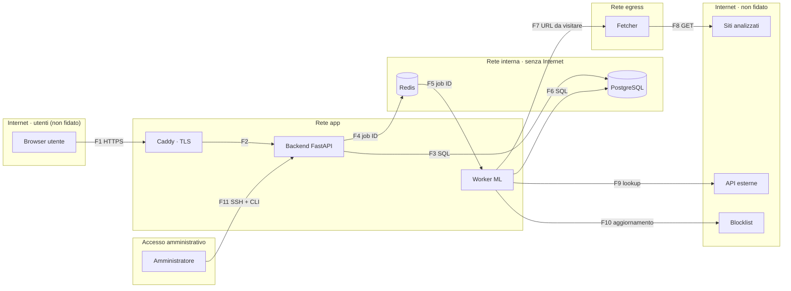

# Threat model — PhishLens

Versione: 0.1 · Ultimo aggiornamento: 2026-10-20 · Autore: Grandi Tommaso

## 1. Scopo e perimetro
PhishLens è una web app che analizza URL ed email sospette e restituisce uno score di rischio da 0 a 100, spiegando con tecniche di ML spiegabile (SHAP) quali caratteristiche hanno determinato il verdetto. È pensata per utenti privati che vogliono capire se un link è pericoloso prima di aprirlo.

**Nel perimetro (MVP):** analisi di URL, spiegazione del verdetto, controllo del dominio in blocklist pubbliche, storico personale delle analisi, gestione dell'account con MFA. Estensione successiva: analisi di file `.eml`.

**Fuori dal perimetro:** verifica della sicurezza del proprio sito, scansioni attive di sistemi terzi, account aziendali con più utenti e ruoli, pannello di amministrazione web.

L'app è uno strumento di supporto alla decisione: i verdetti sono probabilistici e non garantiscono che un URL sia sicuro.

## 2. Use case
<!-- La tabella UC1–UC7 con i criteri di accettazione. -->

## 3. Asset da proteggere

| ID | Asset | Perché è prezioso | Impatto se compromesso |
| --- | --- | --- | --- |
| A1 | Credenziali e sessioni degli utenti | Danno accesso allo storico e all'account | Alto |
| A2 | Chiavi delle API esterne | Hanno quote limitate; un furto permette abusi a mio nome | Medio |
| A3 | Contenuto delle email caricate | Contiene dati personali di terzi (GDPR) | Alto |
| A4 | Storico delle analisi | Rivela cosa un utente sta verificando e perché | Medio |
| A5 | Integrità del modello e dei verdetti | Un verdetto falsato può spingere un utente ad aprire un link di phishing | Alto |
| A6 | Disponibilità del servizio e quote API | Senza di esse l'app non funziona | Medio |
| A7 | Rete interna e infrastruttura | Un attaccante che vi accede può raggiungere database e segreti | Alto |
| A8 | Reputazione dell'IP e del dominio del server | Se l'app viene usata come proxy, l'IP finisce nelle blocklist e il provider può sospendere il server | Medio |

## 4. Attori e livelli di fiducia

| Attore | Livello di fiducia | Cosa può fare legittimamente |
| --- | --- | --- |
| Visitatore anonimo | Nessuno | Vedere la pagina pubblica, registrarsi, effettuare il login |
| Utente registrato | Limitato | Analizzare URL entro le quote, vedere e cancellare solo le proprie analisi, gestire il proprio account |
| Amministratore | Alto | Gestire server e deploy via SSH; amministrare l’app tramite CLI sul server (vedi ADR-001); non esiste un pannello di amministrazione web. |
| Attaccante esterno | Nessuno | Nulla: può agire come visitatore o come utente registrato |
| Contenuto analizzato (URL, pagine, email) | Ostile per definizione | Nulla: è un dato, non deve mai essere eseguito, visitato dal backend o reso come HTML |
| Servizi esterni (VirusTotal, URLScan, blocklist) | Parziale | Forniscono informazioni utili, ma le risposte vanno validate e possono contenere dati scelti da un attaccante |
| Feed di dati per l'addestramento | Parziale | Forniscono esempi di phishing, ma possono essere inquinati (poisoning) |

## 5. Architettura e flussi di dati

| ID | Da → A | Cosa trasporta | Attraversa un confine? | Protezione principale |
| --- | --- | --- | --- | --- |
| F1 | Browser → Caddy | Credenziali, cookie di sessione, URL da analizzare | Sì: Internet → app | TLS, validazione dell'input, rate limit |
| F2 | Caddy → Backend | Richieste HTTP già terminate in TLS | No | Header di sicurezza aggiunti dal proxy |
| F3 | Backend ↔ PostgreSQL | Utenti, sessioni, analisi | Sì: app → rete interna | Query parametrizzate, utente DB con privilegi minimi |
| F4 | Backend → Redis | ID dei job, contatori dei rate limit | Sì: app → rete interna | Password su Redis, serializzazione JSON |
| F5 | Redis → Worker | ID dei job | Sì: rete interna → app | Il worker rilegge i dati dal DB, non si fida del contenuto della coda |
| F6 | Worker ↔ PostgreSQL | Feature, verdetti, spiegazioni | Sì: app → rete interna | Come F3 |
| F7 | Worker → Fetcher | URL da visitare | Sì: app → rete egress | Il fetcher rivalida tutto e non si fida del worker |
| F8 | Fetcher → Siti analizzati | Richieste GET, risposte ostili | Sì: verso Internet non fidato | Verifica degli IP, IP pinning, redirect controllati, limiti di tempo e dimensione |
| F9 | Worker → API esterne | URL o hash; report in risposta | Sì: verso Internet non fidato | TLS con verifica del certificato, chiavi solo lato server, risposte validate |
| F10 | Worker → Blocklist | Download periodico delle liste | Sì: verso Internet non fidato | TLS, controllo del formato prima dell'uso |
| F11 | Amministratore → Server | Comandi della CLI | Sì: Internet → server | SSH con chiave, audit log (ADR-001) |

## 6. Ipotesi di sicurezza

- **I1.** Il provider di hosting e la sua infrastruttura di virtualizzazione sono affidabili.
- **I2.** Sistema operativo, Docker e immagini base vengono aggiornati regolarmente dall'amministratore.
- **I3.** Il sistema delle Certificate Authority e i certificati TLS emessi tramite Let's Encrypt sono affidabili.
- **I4.** Le API esterne possono essere lente, non disponibili o restituire dati errati: l'app deve funzionare anche senza di esse.
- **I5.** Il dispositivo dell'utente non è compromesso: malware sul computer dell'utente è fuori perimetro.
- **I6.** L'attaccante non ha accesso fisico al server né credenziali SSH valide.
- **I7.** Il progetto non è commerciale e non tratta dati di pagamento; l'unico quadro normativo considerato è il GDPR.

## 7. Analisi STRIDE
<!-- Tabella: ID | Categoria | Flusso o componente | Minaccia | Mitigazione | Requisito ASVS | Test -->

## 8. Abuse case
<!-- La tabella AC1–AC12, collegata alle righe STRIDE. -->

## 9. Rischi residui accettati
- **R1.** Il worker ha accesso a Internet per chiamare le API esterne. Mitigazione prevista: limitare le connessioni in uscita ai soli domini delle API.

## 10. Storico delle revisioni
| Versione | Data | Modifica |
| --- | --- | --- |
| 0.1 | AAAA-MM-GG | Prima stesura |