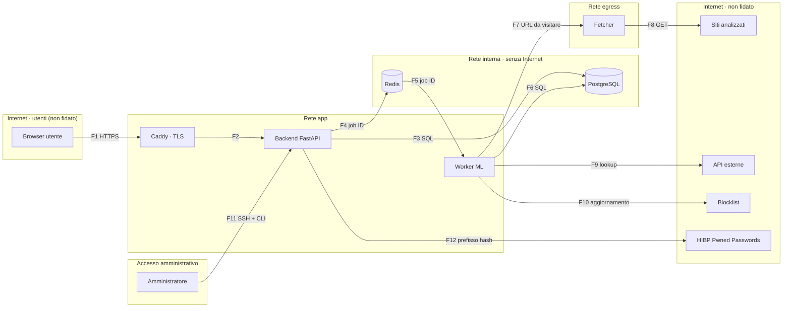

# Threat model — PhishLens

Versione: 0.1 · Ultimo aggiornamento: 2026-10-20 · Autore: Grandi Tommaso

## 1. Scopo e perimetro
PhishLens è una web app che analizza URL ed email sospette e restituisce uno score di rischio da 0 a 100, spiegando con tecniche di ML spiegabile (SHAP) quali caratteristiche hanno determinato il verdetto. È pensata per utenti privati che vogliono capire se un link è pericoloso prima di aprirlo.

**Nel perimetro (MVP):** analisi di URL, spiegazione del verdetto, controllo del dominio in blocklist pubbliche, storico personale delle analisi, gestione dell'account con MFA. Estensione successiva: analisi di file `.eml`.

**Fuori dal perimetro:** verifica della sicurezza del proprio sito, scansioni attive di sistemi terzi, account aziendali con più utenti e ruoli, pannello di amministrazione web.

L'app è uno strumento di supporto alla decisione: i verdetti sono probabilistici e non garantiscono che un URL sia sicuro.

## 2. Use case
## 2. Use case

| ID | User story | Criteri di accettazione |
| --- | --- | --- |
| UC1 | Come utente voglio inviare un URL e ricevere uno score 0–100, per capire se aprirlo | Risposta entro 15 s oppure stato "in elaborazione"; URL oltre 2048 caratteri o con schema diverso da http/https rifiutati con messaggio chiaro; URL mostrato in forma defanged |
| UC2 | Come utente voglio vedere perché un URL è rischioso, per decidere con cognizione | Le 5 cause principali (SHAP) in linguaggio naturale; segnali delle API esterne mostrati separati dal verdetto del modello |
| UC3 | Come utente voglio un giudizio chiaro, per sapere cosa fare | Tre livelli: "nessun segnale di rischio rilevato", "sospetto", "alto rischio"; avviso sui limiti dell'analisi; mai la parola "affidabile" |
| UC4 | Come utente voglio sapere se un dominio compare in blocklist pubbliche, per verificarne la reputazione | Esito per ogni fonte, con data dell'ultimo aggiornamento; controllo solo passivo, nessuna connessione al dominio |
| UC5 | Come utente voglio confrontare un'analisi con le mie precedenti sullo stesso URL, per vedere cosa è cambiato | Solo storico personale; variazione dello score e delle cause; storico limitato al periodo di retention |
| UC6 | Come utente voglio gestire il mio account, per proteggerlo e controllare i miei dati | Registrazione con verifica email, MFA TOTP, esportazione e cancellazione completa dei dati |
| UC7 | Come utente voglio analizzare un'email `.eml` (estensione dopo l'MVP) | Limiti su dimensione e struttura; corpo cancellato dopo l'analisi; allegati trattati solo come hash |

## 3. Asset da proteggere

| ID | Asset | Perché è prezioso | Impatto se compromesso |
| --- | --- | --- | --- |
| A1 | Credenziali e sessioni degli utenti | Danno accesso allo storico e all'account | Alto |
| A2 | Chiavi delle API esterne | Hanno quote limitate; un furto permette abusi a mio nome | Medio |
| A3 | Contenuto delle email caricate | Contiene dati personali di terzi (GDPR) | Alto |
| A4 | Storico delle analisi | Rivela cosa un utente sta verificando e perché | Medio |
| A5 | Integrità del modello e dei verdetti | Un verdetto falsato può spingere un utente ad aprire un link di phishing | Alto |
| A6 | Disponibilità del servizio e quote API | Senza di esse l'app non funziona | Medio |
| A7 | Rete interna e infrastruttura | Un attaccante che vi accede può raggiungere database e segreti | Alto |
| A8 | Reputazione dell'IP e del dominio del server | Se l'app viene usata come proxy, l'IP finisce nelle blocklist e il provider può sospendere il server | Medio |

## 4. Attori e livelli di fiducia

| Attore | Livello di fiducia | Cosa può fare legittimamente |
| --- | --- | --- |
| Visitatore anonimo | Nessuno | Vedere la pagina pubblica, registrarsi, effettuare il login |
| Utente registrato | Limitato | Analizzare URL entro le quote, vedere e cancellare solo le proprie analisi, gestire il proprio account |
| Amministratore | Alto | Gestire server e deploy via SSH; amministrare l’app tramite CLI sul server (vedi ADR-001); non esiste un pannello di amministrazione web. |
| Attaccante esterno | Nessuno | Nulla: può agire come visitatore o come utente registrato |
| Contenuto analizzato (URL, pagine, email) | Ostile per definizione | Nulla: è un dato, non deve mai essere eseguito, visitato dal backend o reso come HTML |
| Servizi esterni (VirusTotal, URLScan, blocklist) | Parziale | Forniscono informazioni utili, ma le risposte vanno validate e possono contenere dati scelti da un attaccante |
| Feed di dati per l'addestramento | Parziale | Forniscono esempi di phishing, ma possono essere inquinati (poisoning) |

## 5. Architettura e flussi di dati

| ID | Da → A | Cosa trasporta | Attraversa un confine? | Protezione principale |
| --- | --- | --- | --- | --- |
| F1 | Browser → Caddy | Credenziali, cookie di sessione, URL da analizzare | Sì: Internet → app | TLS, validazione dell'input, rate limit |
| F2 | Caddy → Backend | Richieste HTTP già terminate in TLS | No | Header di sicurezza aggiunti dal proxy |
| F3 | Backend ↔ PostgreSQL | Utenti, sessioni, analisi | Sì: app → rete interna | Query parametrizzate, utente DB con privilegi minimi |
| F4 | Backend → Redis | ID dei job, contatori dei rate limit | Sì: app → rete interna | Password su Redis, serializzazione JSON |
| F5 | Redis → Worker | ID dei job | Sì: rete interna → app | Il worker rilegge i dati dal DB, non si fida del contenuto della coda |
| F6 | Worker ↔ PostgreSQL | Feature, verdetti, spiegazioni | Sì: app → rete interna | Come F3 |
| F7 | Worker → Fetcher | URL da visitare | Sì: app → rete egress | Il fetcher rivalida tutto e non si fida del worker |
| F8 | Fetcher → Siti analizzati | Richieste GET, risposte ostili | Sì: verso Internet non fidato | Verifica degli IP, IP pinning, redirect controllati, limiti di tempo e dimensione |
| F9 | Worker → API esterne | URL o hash; report in risposta | Sì: verso Internet non fidato | TLS con verifica del certificato, chiavi solo lato server, risposte validate |
| F10 | Worker → Blocklist | Download periodico delle liste | Sì: verso Internet non fidato | TLS, controllo del formato prima dell'uso |
| F11 | Amministratore → Server | Comandi della CLI | Sì: Internet → server | SSH con chiave, audit log (ADR-001) |
| F12 | Backend → api.pwnedpasswords.com | Primi 5 caratteri dell'hash SHA-1 della password | Sì: verso Internet | k-anonymity, TLS con verifica del certificato, uscita del backend consentita solo verso questo dominio, timeout |

## 6. Ipotesi di sicurezza

- **I1.** Il provider di hosting e la sua infrastruttura di virtualizzazione sono affidabili.
- **I2.** Sistema operativo, Docker e immagini base vengono aggiornati regolarmente dall'amministratore.
- **I3.** Il sistema delle Certificate Authority e i certificati TLS emessi tramite Let's Encrypt sono affidabili.
- **I4.** Le API esterne possono essere lente, non disponibili o restituire dati errati: l'app deve funzionare anche senza di esse.
- **I5.** Il dispositivo dell'utente non è compromesso: malware sul computer dell'utente è fuori perimetro.
- **I6.** L'attaccante non ha accesso fisico al server né credenziali SSH valide.
- **I7.** Il progetto non è commerciale e non tratta dati di pagamento; l'unico quadro normativo considerato è il GDPR.

## 7. Analisi STRIDE
| ID | Categoria | Elemento | Minaccia | Mitigazione | Abuse case | ASVS | Test |
| --- | --- | --- | --- | --- | --- | --- | --- |
| S-01 | Spoofing | F1, Backend | Credential stuffing o furto della sessione per prendere il controllo di un account | Argon2id, rate limit sul login, MFA, cookie HttpOnly/Secure/SameSite | AC10 | V6, V7 | `test_login_rate_limit`, `test_session_cookie_flags` |
| T-01 | Tampering | F1 | CSRF: un sito esterno fa compiere azioni all'utente a sua insaputa | Token CSRF, cookie SameSite | — | V3 | `test_csrf_required` |
| R-01 | Repudiation | Backend | Un utente nega di aver cancellato dati o modificato l'account | Audit log delle azioni sensibili | — | V16 | `test_audit_log_events` |
| I-01 | Information disclosure | F1 | Intercettazione del traffico tra browser e server | TLS 1.2 o superiore, HSTS | — | V12 | Verifica con SSL Labs |
| I-02 | Information disclosure | Backend | IDOR: lettura delle analisi di altri utenti cambiando l'ID | Controllo di proprietà centralizzato | AC11 | V8 | `test_idor` |
| D-01 | Denial of service | F1, Backend | Invio massivo di analisi, esaurimento del servizio e delle quote | Rate limit per IP e per utente, quote giornaliere | AC1, AC2 | V2 | `test_quota_exceeded` |
| E-01 | Elevation of privilege | Backend | SQL injection attraverso i campi di input | Query parametrizzate tramite ORM, validazione strict | AC3 | V1 | `test_sql_injection_payloads` |
| E-02 | Elevation of privilege | F7, F8, Fetcher | SSRF: far visitare al fetcher la rete interna o l'endpoint metadata del cloud | Verifica degli IP, IP pinning, redirect rivalidati, isolamento di rete | AC7 | V1, V13 | `test_ssrf` |
| T-02 | Tampering | F8 | La pagina analizzata restituisce contenuti con script che finiscono nell'interfaccia (XSS) | Contenuti mai resi come HTML, escaping, URL defanged | AC3 | V1, V3 | `test_xss_payloads` |
| D-02 | Denial of service | F8 | Il sito risponde lentissimo o con una risposta infinita, bloccando i worker | Timeout totale, dimensione massima della risposta | AC3 | V15 | `test_fetch_limits` |
| R-02 | Repudiation | F8 | Un attaccante usa PhishLens come proxy: le richieste ai siti terzi risultano fatte dal mio server | Solo GET senza header scelti dall'utente, limite per dominio di destinazione, log di ogni richiesta | AC8 | V2 | `test_per_domain_limit` |
| I-03 | Information disclosure | F3, PostgreSQL | Furto delle credenziali del DB: lettura di email, segreti MFA, token di sessione, storico | Credenziali solo come segreti, utente DB con privilegi minimi, segreti TOTP cifrati con chiave esterna al DB, token di sessione salvati come hash | — | V11, V13, V14 | `test_session_tokens_hashed`, `test_totp_secret_encrypted` |
| T-03 | Tampering | PostgreSQL | Con le credenziali del DB, modifica di verdetti, quote o dati degli utenti | Utente DB senza privilegi di modifica dello schema, audit log, backup | — | V13 | Verifica dei permessi dell'utente DB |
| I-04 | Information disclosure | PostgreSQL, Redis | Porta pubblicata per errore nel docker-compose: Docker scavalca ufw e il servizio è esposto su Internet | Nessuna sezione `ports` per db e redis, rete `internal: true`, test in CI sul compose, scansione esterna con nmap | — | V13 | `test_compose_no_exposed_ports`, nmap dopo il deploy |
| I-05 | Information disclosure | Backup | Furto dei backup del database | Backup cifrati, chiave conservata separatamente, copia fuori dal server | — | V14 | Ripristino di prova documentato |
| D-03 | Denial of service | PostgreSQL | Disco pieno o query lente bloccano l'app, anche per abuso volontario | Quote, job di retention, alert sullo spazio disco, `statement_timeout`, pool di connessioni limitato | AC1 | V2 | `test_retention_job`, alert configurato |
| I-06 | Information disclosure | F9, Worker | Chiavi API esposte in un commit, in un log o in un messaggio d'errore | Segreti in variabili d'ambiente, gitleaks, chiavi mascherate nei log, chiavi mai inviate al frontend | AC2 | V13 | gitleaks in CI, `test_logs_no_secrets` |
| T-04 | Tampering | F9 | Le risposte delle API contengono stringhe scelte dall'attaccante che finiscono nell'interfaccia (XSS memorizzata) | Risposte validate con Pydantic, escaping, mai rese come HTML | AC3 | V1 | `test_api_response_xss` |
| T-05 | Tampering | F9 | Man-in-the-middle sulle chiamate alle API: risposte falsificate | TLS con verifica del certificato sempre attiva; regola semgrep contro `verify=False` | — | V12 | Regola semgrep in CI |
| I-07 | Information disclosure | F9 | Gli URL degli utenti, inclusi eventuali token nella query string, diventano visibili a terzi | Ricerca di report esistenti invece dell'invio, visibilità privata, query string rimossa dagli URL inviati all'esterno, informativa | — | V14 | `test_external_url_strips_query` |
| D-04 | Denial of service | F9 | API lenta, non disponibile o con quota esaurita blocca le analisi | Timeout, retry con backoff, circuit breaker, cache, budget giornaliero, risultato parziale | AC2 | V15 | `test_api_timeout_partial_result` |
| S-04 | Spoofing | F2 | Header `X-Forwarded-For` falsificato per cambiare IP apparente e aggirare il rate limit | Il backend accetta l'header solo se arriva da Caddy (proxy fidato) | AC1 | V4 | `test_xff_spoofing_ignored` |
| T-06 | Tampering | F4, F5, Redis | Inserimento di job malevoli nella coda o deserializzazione insicura | Redis con password e solo su rete interna, job in JSON con il solo ID, il worker rilegge i dati dal DB | AC6 | V1 | `test_job_payload_only_id` |
| D-05 | Denial of service | Redis | Coda saturata da job in massa | Limite di job in coda per utente, lunghezza massima della coda | AC1 | V2 | `test_queue_limit_per_user` |
| E-03 | Elevation of privilege | Worker | Un bug nel parsing di contenuti ostili porta all'esecuzione di codice nel worker | Container non root, filesystem in sola lettura, `cap_drop: ALL`, utente DB dedicato con permessi minimi, dipendenze aggiornate, fuzzing | AC3, AC12 | V15 | Trivy, test di fuzzing |
| D-06 | Denial of service | Worker | Email enormi, annidate o con zip bomb esauriscono memoria e CPU | Limiti prima del parsing, allegati solo come hash, timeout per job | AC12 | V5 | `test_eml_limits` |
| S-05 | Spoofing | F7, Fetcher | Un processo diverso dal worker invia richieste al fetcher | Il fetcher accetta richieste solo dalla sua rete dedicata e con un token condiviso | AC7 | V13 | `test_fetcher_rejects_without_token` |
| T-07 | Tampering | F10 | Blocklist manipolata (fonte compromessa o man-in-the-middle) che altera i verdetti | TLS, controllo di formato e dimensione, nuova versione scartata se cambia in modo anomalo | — | V12 | `test_blocklist_validation` |
| T-08 | Tampering | File del modello | Sostituzione del modello con uno manomesso | Formato JSON nativo, hash SHA-256 verificato all'avvio, montaggio in sola lettura | AC6 | V15 | `test_model_hash_mismatch` |
| T-09 | Tampering | Dati di addestramento | Data poisoning tramite feed pubblici | Deduplica, test set fisso verificato a mano, gate di rilascio | AC4 | Fuori da ASVS (ML) | Gate di rilascio in pipeline |
| T-10 | Tampering | Modello | Evasione: URL costruito per abbassare lo score | Test adversarial, segnali esterni indipendenti dal modello | AC5 | Fuori da ASVS (ML) | Report adversarial nella model card |
| I-08 | Information disclosure | Backend | Un phisher usa score e spiegazioni come oracolo per capire come eludere il modello | Rate limit, spiegazioni dettagliate solo agli utenti autenticati, alert su molte varianti dello stesso dominio | AC9 | V2 | `test_variant_alert` |
| S-06 | Spoofing | F11 | Furto della chiave SSH dell'amministratore | Chiave con passphrase, login root disattivato, fail2ban, accesso SSH limitato | — | V13 | Verifica della configurazione SSH |
| R-03 | Repudiation | F11, Audit log | Chi ha accesso al database può alterare l'audit log | Copia dei log su file append-only o servizio esterno | — | V16 | Verifica della copia dei log |
| E-04 | Elevation of privilege | Backend | Mass assignment: l'utente modifica campi riservati (quota, stato account, owner_id) aggiungendoli al JSON | Schemi di input separati con `extra="forbid"`, `owner_id` preso dalla sessione | AC1 | V8 | `test_mass_assignment` |
| E-05 | Elevation of privilege | Fetcher | Differenze tra parser di URL usate per aggirare i controlli SSRF (es. `http://pubblico.com@127.0.0.1/`) | Un solo parser e un solo oggetto URL normalizzato dall'ingresso al client HTTP | AC7 | V1 | `test_ssrf_parser_differential` |
| D-07 | Denial of service | Worker | ReDoS: un URL costruito apposta blocca un'espressione regolare | Regex semplici, lunghezza limitata prima del confronto, timeout per job | AC3 | V1 | `test_regex_redos_inputs` |
| T-11 | Tampering | Backend | Race condition: richieste parallele superano la quota o riusano un codice monouso | Aggiornamenti atomici condizionali nel database | AC1, AC10 | V2 | `test_quota_race_condition`, `test_recovery_code_race` |

## 8. Abuse case

| ID | Attaccante e obiettivo | Come ci prova | Difesa | Righe STRIDE |
| --- | --- | --- | --- | --- |
| AC1 | Utente che vuole uso illimitato | Supera la quota, crea molti account o modifica campi riservati | Quota per account, verifica email, limite di registrazioni per IP, aggiornamenti atomici, `extra="forbid"` | D-01, D-03, D-05, S-04, E-04, T-11 |
| AC2 | Chi vuole esaurire le quote API | Invia in massa URL sempre diversi | Cache, budget giornaliero per servizio, analisi parziale oltre il budget | D-01, I-06, D-04 |
| AC3 | Chi vuole attaccare l'analizzatore con l'input | XSS nell'URL o nel titolo della pagina, URL enormi o malformati, trucchi punycode, regex lente (ReDoS) | Validazione strict, escaping, URL defanged, normalizzazione IDNA, regex semplici e input limitato | E-01, T-02, D-02, T-04, E-03, D-07 |
| AC4 | Chi vuole avvelenare il modello | Inserisce dati costruiti nei feed usati per il riaddestramento | Deduplica, test set fisso verificato a mano, gate di rilascio | T-09 |
| AC5 | Phisher che vuole eludere il modello | Modifica l'URL quanto basta per abbassare lo score | Valutazione adversarial, segnali esterni indipendenti dal modello | T-10 |
| AC6 | Chi vuole manomettere il modello o la coda | Sostituisce il file del modello o inserisce job malevoli | Formato JSON, hash verificato, sola lettura; coda solo con ID | T-08, T-06 |
| AC7 | Chi vuole scansionare la rete interna (SSRF) | URL verso IP privati, metadata cloud, redirect, DNS rebinding, differenze tra parser di URL | Fetcher isolato, verifica degli IP, IP pinning, redirect rivalidati, un solo parser di URL | E-02, S-05, E-05 |
| AC8 | Chi vuole usare l'app come proxy verso terzi | Invia in massa URL dello stesso sito bersaglio | Solo GET senza header o corpo scelti dall'utente, limite per dominio di destinazione, log delle richieste | R-02 |
| AC9 | Phisher che usa l'app come oracolo | Prova varianti della propria pagina finché lo score scende | Rate limit, spiegazioni dettagliate solo agli autenticati, alert su molte varianti dello stesso dominio | I-08 |
| AC10 | Chi vuole prendere il controllo di un account | Credential stuffing, furto della sessione, riuso di codici monouso con richieste parallele | Argon2id, rate limit sul login, MFA, controllo password violate, aggiornamenti atomici | S-01, T-11 |
| AC11 | Utente che vuole leggere analisi altrui | Cambia l'ID nella richiesta (IDOR) | Controllo di proprietà centralizzato | I-02 |
| AC12 | Chi vuole bloccare il servizio con email ostili | File `.eml` enormi, annidati, zip bomb negli allegati | Limiti prima del parsing, allegati solo come hash, parsing nel worker | E-03, D-06 |

## 9. Rischi residui accettati
- **R1.** Il worker ha accesso a Internet per chiamare le API esterne. Mitigazione prevista: limitare le connessioni in uscita ai soli domini delle API.
- **R2.** I dati di un utente cancellato restano nei backup fino alla loro scadenza (es. 30 giorni). Dichiarato nell'informativa.
- **R3.** Il traffico tra backend e database non è cifrato: resta sulla rete Docker interna dello stesso host.
- **R4.** L'audit log è nel database: chi ottiene accesso al DB può alterarlo. Copia esterna dei log prevista dopo l'MVP.
- **R5.** Se HIBP non risponde, la password viene accettata dopo i soli controlli locali. Bloccare le registrazioni sarebbe peggio.

## 10. Storico delle revisioni
| Versione | Data | Modifica |
| --- | --- | --- |
| 0.1 | AAAA-MM-GG | Prima stesura |
